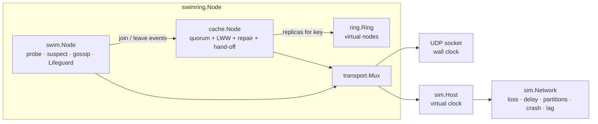
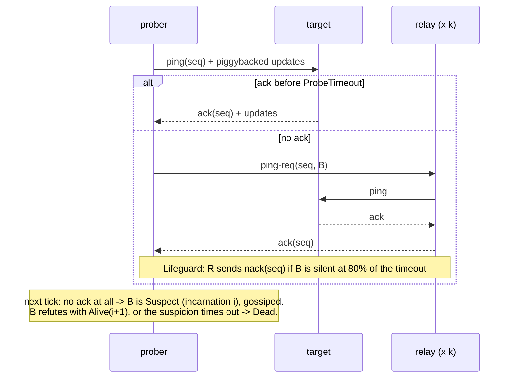

# swimring

[](https://github.com/SlateGitOrg/swimring/actions/workflows/ci.yml)

A from-scratch Go implementation of the **SWIM** gossip membership protocol
with the **Lifeguard** extensions, a **consistent-hash ring** with virtual
nodes, and a small **replicated cache** on top. It runs over real UDP or
inside a **deterministic network simulator** (loss, delay, partitions,
crashes, slow members, virtual clock), and the simulator is used to measure
the protocol against the analysis in the SWIM paper.

- No dependencies outside the Go standard library.
- The same protocol code runs on UDP with the wall clock and in the
  simulator: nodes own no goroutines and take time from an injected clock.
- Every number in this README comes from a committed command, shown next to it.

## Why

Engineers who want to see how a production-style membership layer works
inside: how the failure detector, suspicion and incarnation numbers, gossip
and Lifeguard's local-health logic fit together, and how membership drives
data placement. It is also a test bench: change a parameter, rerun
`make eval`, and get the same measurement tables on any machine.
It is a reference and teaching implementation, not a replacement for
`hashicorp/memberlist` (see [Limitations](#limitations)).

## What is implemented

| area | details |
|---|---|
| failure detection | direct `ping`, indirect `ping-req` through k relays, shuffled round-robin targets (time-bounded completeness), per-period probe |
| suspicion | Suspect state with incarnation numbers, refutation by the accused, tombstones for Dead/Left, graceful leave |
| dissemination | infection-style piggybacking on every protocol message, λ·log n retransmissions, least-sent-first |
| Lifeguard | Local Health Multiplier scaling probe interval and timeout; dynamic suspicion timeouts that shrink with independent confirmations; relay nacks; buddy system. Each part can be switched on or off |
| anti-entropy | join with retries, periodic push-pull, reconnect attempts to dead members so partitions merge after they heal; large tables split into self-contained UDP chunks |
| ring | V virtual nodes per member, FNV-1a + splitmix64, immutable rings behind an atomic pointer, `LookupN` for replica sets |
| cache | N/W/R quorum replication (3/2/2), last-writer-wins on Lamport versions, tombstones, read repair, hand-off on membership change |
| transports | `transport.UDP` (real sockets), `sim.Host` (simulated), one-byte channel mux so SWIM and the cache share a socket |
| tooling | `swimring sim / eval / demo / node` CLI; wire decoders and ring fuzzed; race-detector tests |

## Architecture



One protocol period on one member (T = 1 s by default):



Package map, algorithms and costs are in [docs/ARCHITECTURE.md](docs/ARCHITECTURE.md).

## Quickstart

Requires Go 1.24 or newer. `make check` also needs `golangci-lint` v2 on the `PATH`.

```sh
make check      # gofmt, go vet, golangci-lint, tests with -race, coverage gate (>= 80%)
make demo       # offline end-to-end demo: simulated cluster, then 4 real UDP nodes on 127.0.0.1
make eval       # regenerate results/EVAL.md (seeded simulations, about 2 minutes)
make bench      # micro-benchmarks
make fuzz       # 20 s per fuzz target

go run ./cmd/swimring sim -n 64 -loss 0.1 -crash 2 -duration 60s   # one scenario, printed as a timeline
go run ./cmd/swimring sim -n 32 -crash 0 -slow 2 -lag 2s -lifeguard=false
```

A real cluster across terminals (each node has a small shell: `members`,
`put k v`, `get k`, `del k`, `owners k`, `stats`, `leave`):

```sh
go run ./cmd/swimring node -name a -bind 127.0.0.1:7001
go run ./cmd/swimring node -name b -bind 127.0.0.1:7002 -join 127.0.0.1:7001
go run ./cmd/swimring node -name c -bind 127.0.0.1:7003 -join 127.0.0.1:7001
```

As a library:

```go
tr, _ := transport.ListenUDP("10.0.0.5:7946", nil)
n, _ := swimring.New(swimring.Options{
    SWIM:      swim.DefaultConfig("node-5"),
    Cache:     cache.DefaultConfig(),
    Transport: tr,
    Clock:     clock.NewReal(),
    Rand:      rand.New(rand.NewPCG(seed1, seed2)),
})
_ = n.Start()
_ = n.Join("10.0.0.1:7946")
_ = n.Cache.Put(ctx, "user:42", []byte("..."))
```

## Demo output

`make demo`, pasted from a real run. Part 1 is deterministic (seed 7); the
UDP part runs on the wall clock, so ports and timings vary between runs.

```text
== Part 1: simulated cluster (8 nodes, seed 7, deterministic) ==

[join] all 8 members see each other after 1.708s of virtual time
[ring] 128 vnodes/member, primary ownership: n0=13.3% n1=13.4% n2=13.3% n3=12.0% n4=12.0% n5=12.9% n6=11.3% n7=11.8%
[cache] wrote 60 keys (N=3, W=2, R=2) through rotating coordinators
        user:007 -> replicas [n0 n6 n2]
        user:042 -> replicas [n5 n4 n2]

[crash] n5 crashes at t=3.987s (no goodbye)
  t=  5.705s n7: n5 is suspect (inc 0, source n7)
  t=  5.708s n1: n5 is suspect (inc 0, source n7)
  t=  5.717s n2: n5 is suspect (inc 0, source n7)
  t=  5.725s n0: n5 is suspect (inc 0, source n7)
  t=  5.756s n3: n5 is suspect (inc 0, source n7)
  t=  5.813s n4: n5 is suspect (inc 0, source n2)
  t=  6.085s n6: n5 is suspect (inc 0, source n2)
  t=  9.705s n7: n5 is dead (inc 0, source n7)
  t=  9.707s n4: n5 is dead (inc 0, source n7)
  t=  9.708s n1: n5 is dead (inc 0, source n1)
  t=  9.717s n2: n5 is dead (inc 0, source n2)
  t=  9.725s n0: n5 is dead (inc 0, source n0)
  ... 2 more events
[detect] every survivor removed n5 5.828s after the crash
[cache] after hand-off (52 copies sent): 60/60 keys readable, 60/60 back at 3 live replicas

[partition] network split [n0 n1 n2 n3] | [n4 n6 n7]
  t= 14.470s n1: n4 is suspect (inc 0, source n1)
  t= 14.705s n7: n1 is suspect (inc 0, source n7)
  t= 14.751s n3: n7 is suspect (inc 0, source n3)
  t= 14.755s n0: n7 is suspect (inc 0, source n3)
  t= 14.816s n2: n7 is suspect (inc 0, source n3)
  t= 14.824s n1: n7 is suspect (inc 0, source n3)
  ... 40 more events
[partition] after 18.6s each side sees only itself: n0 sees 4 live, n7 sees 3 live
[heal] partition healed; reconnect probes + refutations re-merged all 7 survivors in 3.1s
[net] 3558 packets sent, 3292 delivered, 227 dropped by partition, 39 sent to the crashed host

== Part 2: real UDP on 127.0.0.1 (4 nodes, wall clock, T=200ms) ==

[udp] udp0 listening on 127.0.0.1:55523
[udp] udp1 listening on 127.0.0.1:61686
[udp] udp2 listening on 127.0.0.1:55064
[udp] udp3 listening on 127.0.0.1:61539
[udp] converged in 61ms
[udp] put 5 keys; udp0 holds 5 replicas locally
[udp] killed udp3 (socket closed, no leave message)
[udp] all survivors declared udp3 dead after 1.2s (wall clock)
[udp] 5/5 keys still readable; live members: [udp0 udp1 udp2]
```

Reading the crash timeline: n7 is the first to ping n5 after the crash.
That probe fails, so n7 suspects n5 and the suspicion reaches every
survivor within 0.4 s. The other members' own failed probes count as independent
confirmations, which shrinks Lifeguard's suspicion timeout from β·min to
min. n5 is declared dead 4 s later, and that declaration has reached every
survivor 5.8 s after the crash.

## Evaluation

All tables below are excerpts of [results/EVAL.md](results/EVAL.md),
produced by `make eval` (`go run ./cmd/swimring eval -out results/EVAL.md`,
base seed 2002, about 2 minutes). Every number in them is simulated: they
measure this implementation on the simulated network, not a real
deployment. Defaults are T = 1 s, probe timeout 500 ms, k = 3, λ = 4, α = 4,
β = 6, and 1–4 ms one-way latency. Latencies are in protocol periods T.

### 1. Detection time vs cluster size and loss, compared with the paper

Each cell has 40 trials. Each trial crashes one random member at a random
phase of the period. *First ping* counts the period in which a survivor
first pings the dead member. That is the quantity SWIM §3.1 analyses: with
random target choice it has expectation 1/(1−(1−1/(n−1))^(n−1)), which tends
to e/(e−1) ≈ 1.582. This implementation uses shuffled round-robin; its
expectation (derived in docs/ARCHITECTURE.md) is shown as well.

| n | loss | detected | first ping (mean) | paper E[·] random | E[·] round-robin | first suspect | first dead | dead everywhere (mean / p95) | dissemination / ln n |
|---:|---:|---:|---:|---:|---:|---:|---:|---:|---:|
| 8 | 0% | 40/40 | 1.60 | 1.51 | 1.46 | 1.99 | 6.05 | 7.33 / 9.66 | 0.62 |
| 16 | 5% | 40/40 | 1.52 | 1.55 | 1.52 | 1.84 | 6.69 | 7.82 / 9.58 | 0.41 |
| 32 | 0% | 40/40 | 1.73 | 1.57 | 1.55 | 2.13 | 8.17 | 10.11 / 12.73 | 0.56 |
| 64 | 10% | 40/40 | 1.70 | 1.57 | 1.57 | 2.03 | 9.27 | 11.13 / 13.90 | 0.45 |
| 128 | 0% | 40/40 | 1.68 | 1.58 | 1.57 | 2.08 | 10.51 | 13.32 / 15.61 | 0.58 |
| 128 | 10% | 40/40 | 1.48 | 1.58 | 1.57 | 1.68 | 10.10 | 12.00 / 13.73 | 0.39 |

(15 cells in the full table; every crash was detected everywhere and no
healthy member was declared dead in any of the 600 trials.)

- **First detection matches the paper.** Across the full grid the
  first-ping mean lies between 1.40 and 1.73 periods, around the predicted
  1.46–1.58. That spread is sampling noise: the distribution has a
  standard deviation of about one period, so with 40 trials per cell the
  standard error is about 0.15. Message loss does not change
  it, as the analysis predicts: a dead member is not pinged any sooner or
  later because packets drop.
- **Time to declare dead grows with log n**, because the minimum suspicion
  timeout is α·log10(n)·T: about 6 periods at n = 8 and 10.5 at n = 128.
- **Dissemination is O(log n).** Getting the death notice from the first
  declarer to every survivor takes a roughly constant 0.4–0.6 × ln n
  periods from n = 8 to n = 128.
- **Lifeguard's cost on real failures is small.** With Lifeguard off, the
  first death declaration comes at 5.75 / 8.07 / 10.38 periods for
  n = 8 / 32 / 128, against 6.05 / 8.17 / 10.51 with it on (EVAL §2).
  Independent confirmations shrink the dynamic timeout to its minimum almost
  at once.

### 2. False positives under message loss vs the paper's loss model

These are healthy clusters run for 1,000 periods with independent loss p on
every packet. A probe of a live member fails only if the direct ping/ack
pair loses a message and every one of the k four-message indirect paths
does too: P = (1−(1−p)²)·(1−(1−p)⁴)^k.

| n | loss | probes | measured P(fail) | model P(fail) | z | false death declarations, Lifeguard on | …Lifeguard off |
|---:|---:|---:|---:|---:|---:|---:|---:|
| 64 | 5% | 63932 | 4.38e-04 | 6.22e-04 | −1.9 | 0 | 0 |
| 64 | 10% | 62646 | 7.77e-03 | 7.73e-03 | +0.1 | 2 | 22 |
| 64 | 20% | 47156 | 7.44e-02 | 7.41e-02 | +0.3 | 53 | 3922 |
| 64 | 30% | 20041 | 2.21e-01 | 2.24e-01 | −1.1 | 1674 | 16739 |
| 128 | 10% | 125376 | 8.04e-03 | 7.73e-03 | +1.3 | 0 | 2 |
| 128 | 20% | 95326 | 7.25e-02 | 7.41e-02 | −1.9 | 9 | 532 |

- **The measured per-probe failure rate agrees with the model** in all 24
  cells (both Lifeguard settings, n ∈ {16, 64, 128},
  p ∈ {5, 10, 20, 30}%): |z| ≤ 1.9 throughout. This checks the simulator
  and the probe logic together.
- **The suspicion mechanism absorbs most failed probes.** Most suspicions
  are refuted. At 10% loss almost no live member is declared dead, even
  though one probe in 130 fails.
- **Lifeguard cuts false deaths under heavy loss** (64 nodes, 20% loss:
  53 against 3,922 death declarations). Part of the reason is that LHM
  backs off: with Lifeguard on, the cluster sent 47,156 probes instead of
  64,000, so it also probes, and detects real failures, less often while
  the network is that lossy.
- At 30% loss neither variant keeps membership stable.

### 3. Lifeguard ablation: slow members

The cluster has 32 members. Two of them handle every inbound packet late
while their timers stay on time, which models a starved receive path.
These are the false positives Lifeguard was designed to prevent. Lag
2 s, 3 runs × 300 periods:

| variant | accusations of healthy members | healthy death declarations | healthy members lost | slow-member death declarations | max LHM on slow |
|---|---:|---:|---:|---:|---:|
| SWIM (Lifeguard off) | 1639 | 136 | 45 | 7 | 0 |
| + local health (LHM + nack) | 10 | 4 | 3 | 229 | 7 |
| + dynamic suspicion + buddy | 1639 | 1 | 1 | 6 | 0 |
| Lifeguard (all) | 10 | 0 | 0 | 147 | 7 |

- **LHM stops slow members from accusing healthy ones**: 1,639 accusations
  drop to 10. The slow members' health scores saturate near the cap
  (S − 1 = 7), so their own timeouts stretch past their lag.
- **Dynamic suspicion stops the accusations that remain from killing
  anyone.** It needs independent confirmations, and healthy members do not
  confirm a slow member's accusation. On its own it brings healthy deaths
  from 136 to 1.
- **Both together: no healthy member lost** at 1.2 s, 2 s and 4 s of lag
  (EVAL §4a–4c).
- **Trade-off, observed and not hidden:** with LHM on, the *slow* members
  are declared dead more often (229 against 7 at 2 s lag). A member with a
  high score probes, and so gossips, up to 8× less often. Its refutations
  of suspicions about itself therefore spread more slowly, and peers time
  it out. Whether a badly degraded member should count as failed is a
  policy question; this implementation reports the behaviour rather than
  tuning it away.

### 4. Ring balance and key movement

Shares are pooled over 10 random sets of node names. Theory: one node's
share is Beta(V, P−V), so its relative standard deviation is
√((P−V)/(V(P+1))) ≈ 1/√V.

| nodes | vnodes | rel. std of share | theory | max/mean | keys moved on join | ideal 1/(N+1) |
|---:|---:|---:|---:|---:|---:|---:|
| 100 | 1 | 0.943 | 0.990 | 6.686 | 0.0135 | 0.0099 |
| 100 | 16 | 0.247 | 0.249 | 1.980 | 0.0108 | 0.0099 |
| 100 | 64 | 0.127 | 0.124 | 1.453 | 0.0102 | 0.0099 |
| 100 | 256 | 0.061 | 0.062 | 1.224 | 0.0099 | 0.0099 |

The balance and minimal-disruption properties are also unit tests
(`ring/ring_test.go`): insertion-order independence, distinct replica sets,
keys move only to a joining node or away from a leaving one, and pooled
spread within 20% of theory.

### Benchmarks

`make bench` (`go test -run '^$' -bench . -benchmem ./ring ./swim ./cache`)
on the development machine (Apple silicon, Go 1.27, 8 cores, shared with
other jobs, so treat these as orders of magnitude):

| benchmark | result |
|---|---|
| `ring.Lookup`, 100 nodes × 256 vnodes | 71.85 ns/op, 1 alloc |
| `ring.Lookup`, 1,000 nodes × 256 vnodes | 83.41 ns/op |
| `ring.LookupN(3)`, 100 × 256 | 141.7 ns/op |
| `ring.Add` one node to 100 × 256 | 204,443 ns/op |
| encode ping with 8 piggybacked updates | 159.8 ns/op, 1 alloc |
| decode the same packet | 432.9 ns/op (681 MB/s) |
| broadcast queue `Take`, 1,024 queued | 13,216 ns/op |
| one protocol period of a whole simulated 128-member cluster | 247,923 ns/op |
| cache message encode + decode (256-byte value) | 199.0 ns/op |

### Test suite and coverage

`make check` runs unit, integration (simulated clusters, loopback UDP),
property (`testing/quick` and seeded loops) and fuzz-seed tests under the
race detector. It then enforces the coverage gate with
`go test -coverpkg=./,./clock,./transport,./sim,./swim,./ring,./cache,./experiment -coverprofile=coverage.out ./...`
followed by `scripts/coverage.sh`. Core coverage: **94.4%** on the fresh-clone run and 94.5% on the next local run (the loopback UDP tests run on the wall clock, so coverage moves by about 0.1 point between runs)
(the CLI is excluded from the gate).

## Design decisions

The full list, with the cost of each choice, is in [DECISIONS.md](DECISIONS.md). The main ones:

- **Clock and transport injection, no goroutines in the protocol.** This
  makes the simulator exact: identical seeds replay identical event traces,
  and `TestDeterministicReplay` checks it. It also lets the same code run
  on UDP.
- **Round-robin probing**, compared against both the paper's random-choice
  formula and its own round-robin expectation, so the comparison stays
  honest.
- **Dead records in a full-state sync are downgraded to Suspect**, and
  members periodically try to reach Dead ones. Without this, a healed
  partition never merges.
- **Two fixes driven by failing tests.** A node re-announces itself when it
  sees an outdated claim about itself, because gossip budgets can miss a
  member. The cache runs an ownership sweep, because peers with stale ring
  views can push copies back.
- **Suspect members keep their place on the ring.** Transient suspicions
  under loss do not shuffle data.

## Project layout

```text
swimring.go       Node: SWIM + ring + cache wired onto one transport
swim/             failure detector, suspicion, gossip, Lifeguard, anti-entropy
ring/             consistent-hash ring with virtual nodes
cache/            quorum-replicated cache (LWW, read repair, hand-off)
transport/        UDP transport and channel mux
sim/              deterministic network simulator and virtual clock
clock/            injectable clock (real and virtual)
experiment/       seeded experiments behind results/EVAL.md
cmd/swimring/     CLI: sim, eval, demo, node
docs/             ARCHITECTURE.md; DECISIONS.md records design rulings
```

## Limitations

- **The evaluation is simulated.** Loss is independent and uniform. The
  latency model is simple (fixed delay plus uniform jitter, no queueing, no
  bandwidth limit). "Slow member" means one specific model, lagged inbound
  processing with on-time timers. Real networks have bursty, correlated
  loss and asymmetric links, and these results do not transfer to them
  automatically. The UDP path is only exercised on loopback with up to
  4 nodes.
- **Not hardened for untrusted networks.** There is no authentication or
  encryption, and any host that can send UDP to a member can forge
  membership updates (for example, declare others dead at a high
  incarnation). The ring hash is unkeyed.
- **The cache is a demonstration, not a database.** Data lives in memory
  only. Concurrent writes to one key are resolved by last-writer-wins on
  Lamport versions, so one of them silently loses; there are no vector
  clocks or siblings. Writes that are ordered in real time are not lost:
  a replica only acknowledges a version it holds, and a coordinator whose
  counter is behind retries with a higher version (this relies on
  W > N/2 and holds while the key's replica set is unchanged). Writers
  racing on one key can exhaust the retries and get `ErrConflict`. There is no hinted hand-off: a write that reaches
  fewer than W replicas fails. Tombstones expire after a TTL, so a replica
  partitioned for longer than that can resurrect a deleted key. Values are
  limited to 1 KiB so that a request fits in one datagram.
- **No TCP fallback.** memberlist falls back to TCP for probes and for
  large state exchanges; this implementation uses UDP only. Large tables are
  chunked, but a very large cluster's sync is many datagrams.
- **No metadata or user-event channel**, no encryption keyring and no
  protocol-version negotiation beyond a version byte.
- **Stale gossip about a member forgotten after `DeadRetention`** (default
  5 min) could, in principle, re-add it at an old incarnation. This window
  exists in SWIM implementations generally.
- **Scale tested:** up to 128 simulated members (evaluation and
  benchmarks). Behaviour at thousands of members is not measured.

## Roadmap

- Correlated-loss (Gilbert–Elliott) and asymmetric-link models in `sim`,
  and a CPU-starvation model where timers are lagged too.
- Optional HMAC-authenticated packets (shared key), and a keyed ring hash.
- Hinted hand-off and Merkle-tree anti-entropy for the cache.
- An interoperability test against `hashicorp/memberlist`'s behaviour on
  the same simulated scenarios (as a separate module, to keep this one
  dependency-free).
- Prometheus-style metrics export for the `node` command.

## Data

No external datasets are used. All evaluation inputs are generated by the
seeded simulator in this repository.

## License

MIT — see [LICENSE](LICENSE).
