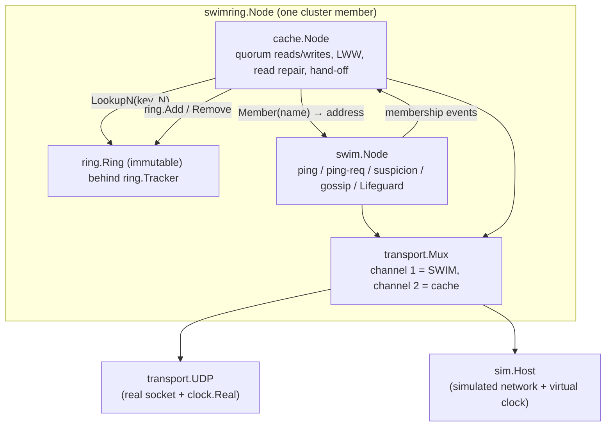

# Architecture

This document describes how swimring is put together, the algorithms in
each layer, and their costs. The README has the overview and the measured
results; `DECISIONS.md` records why each choice was made.

## Layers

| package | role | non-test lines |
|---|---|---:|
| `clock` | `Clock`/`Timer` interfaces; wall-clock implementation | 42 |
| `transport` | datagram `Transport` interface, one-byte channel `Mux`, real `UDP` | 280 |
| `sim` | discrete-event simulator, lossy partitionable network, crash and lag injection | 502 |
| `swim` | the membership protocol | 2,013 |
| `ring` | consistent-hash ring with virtual nodes, atomic `Tracker` | 301 |
| `cache` | replicated cache on the ring | 961 |
| `swimring` (root) | wires a mux, a SWIM node and a cache node together | 105 |
| `experiment` | seeded experiments, analytical models, markdown reports | 830 |
| `cmd/swimring` | CLI: `sim`, `eval`, `demo`, `node` | 878 |

Line counts: `for d in clock transport sim swim ring cache experiment cmd/swimring; do ls $d/*.go | grep -v _test | xargs cat | wc -l; done` (comments included).

### The determinism contract

A `swim.Node` (and a `cache.Node`) owns no goroutines. It advances only when

1. a packet arrives (`Transport` handler → `HandlePacket`), or
2. a timer it scheduled on its injected `clock.Clock` fires.

Every entry point takes the node's mutex, does its work, then releases the
lock and only afterwards runs queued user callbacks (membership events,
trace records). `Clock.AfterFunc` is required never to run its callback
synchronously, so scheduling a timer under the lock is always safe.

With `clock.Real` and `transport.UDP` this is ordinary concurrent code
(timers fire on runtime goroutines, the socket has a read loop; `make check`
runs the tests under the race detector). With `sim.Host` both inputs come
from one event queue on one goroutine, and every random choice comes from a
`math/rand/v2` PCG stream derived from the simulation seed. No protocol path
iterates a Go map where the order could matter, because map order is
randomised per process. The result is bit-for-bit replay, asserted by
`swim.TestDeterministicReplay` (hash of the full event trace under 10% loss
and a crash, run twice).

## swim: the protocol

### Protocol period

Each node runs a `tick` every `ProbeInterval` T (scaled by the Local Health
Multiplier, below). A tick

1. **closes the previous probe**: if no ack arrived, directly or through a
   relay, the target becomes `Suspect`; the health score is adjusted;
2. **starts the next probe**: pick the next target from a shuffled
   round-robin list of live members, send `ping(seq, target)`, arm a timer
   for `ProbeTimeout`;
3. on that timer, if still unacknowledged, send `ping-req(seq, target)` to
   k random Alive members. Each relay pings the target with its own sequence
   number and forwards the ack to the requester under the requester's
   sequence number. With Lifeguard's nack extension the relay also sends a
   `nack` if the target has not answered after 80% of the probe timeout.

Round-robin with reshuffling at the end of each round gives SWIM's
time-bounded completeness: a failed member is pinged by every survivor
within n−1 periods. New members are inserted at a random position in the
unprobed part of the current round (SWIM §4.3).

### Membership state and incarnations

Each member record is `(state, incarnation)` with state ∈ {Alive, Suspect,
Dead, Left}. Only the member itself increments its incarnation, and only to
refute a claim about itself. Merge precedence for an update about member M
with incarnation i against the local record (s, j):

| update | applies when |
|---|---|
| Alive(i) | i > j (any state) — the only way back from Dead/Left |
| Suspect(i) | s ∈ {Alive, Suspect} and (i > j, or s = Alive and i = j); Suspect at i = j is a confirmation |
| Dead(i) | s ∈ {Alive, Suspect} and i ≥ j |
| Left(i) | s ≠ Left and i ≥ j |

Claims about the local node: Suspect/Dead/Left at i ≥ own incarnation are
refuted by setting incarnation = i + 1 and gossiping Alive. A claim at an
older incarnation means the sender never saw an earlier refutation, so the
node re-queues its current Alive (see DECISIONS.md for the failing test that
motivated this). Dead and Left records are tombstones kept for
`DeadRetention`, which stops stale Alive gossip from resurrecting them.

### Dissemination

There are no separate gossip messages: every ping, ping-req, ack and nack
carries as many queued updates as fit in `MaxPacketSize` (1,400 bytes by
default). The queue holds at most one update per member (a newer assertion
replaces the older one) and serves the least-transmitted updates first,
newest first among ties; each update is retired after
λ·⌈log10(n+1)⌉ transmissions. `Take` sorts the queue: O(q log q) per packet
for q queued updates (q ≤ n), which `BenchmarkBroadcastTake` measures at
≈ 13 µs for q = 1,024.

Infection-style spreading reaches every member in O(log n) periods; the eval
table reports "dissemination / ln n", which stays roughly constant
(0.4–0.6) from n = 8 to n = 128.

### Suspicion timeout and Lifeguard

A suspicion expires into Dead after a timeout. Plain SWIM (as in memberlist
without Lifeguard) uses a fixed

    min = α · max(1, log10 n) · T

Lifeguard's **dynamic suspicion** starts at max = β·min and shrinks as k
independent members confirm the suspicion:

    timeout(c) = max(min, max − (max − min) · log(c+1) / log(k+1))

with k = α − 2. When a member really failed, every survivor probes it and
suspects it independently, so confirmations arrive within a few periods and
the timeout drops to `min`: the eval shows almost no detection-latency cost
(first death declaration 10.5 vs 10.4 periods at n = 128).

The **Local Health Multiplier** (LHM) is a saturating score in [0, S−1]
that multiplies both the probe interval and the probe timeout by score+1.
It goes up on evidence that the local node is the slow one (a failed probe:
+1, or +(missing nacks) when nacks were requested; having to refute a claim
about itself: +1) and down by one per successful probe.

The **buddy system** piggybacks the current suspicion onto every ping sent
to a suspected member, ahead of the normal queue, so the suspect learns
about it in one hop and can refute.

### Joining and anti-entropy

`Join` sends a `sync` packet (the node's full table, split into
self-contained chunks of at most `MaxPacketSize`) to the seeds with the
want-reply flag, and retries until another member is known. Two periodic
syncs repair what gossip misses: push-pull with a random live member every
`PushPullInterval`, and **reconnect** with a random Dead member every
`ReconnectInterval`. Dead records received in a sync are downgraded to
Suspect, so a member falsely declared dead by the other half of a partition
gets to refute. That is how two halves of a healed partition merge: in the
demo, 7 survivors re-merge 3.1 s after the heal.

### Wire format

    packet  := version:u8 type:u8 header updates
    header  := ping: seq target source | ping-req: seq target targetAddr source flags
             | ack: seq | nack: seq | sync: flags source
    updates := count:uvarint (kind:u8 name addr incarnation:uvarint from)*

Strings are a one-byte length plus bytes (max 255). The decoder rejects
unknown versions and types, bounds the update count by the remaining bytes
before allocating, and rejects trailing bytes. `FuzzDecodePacket` checks
that it never panics and that anything accepted re-encodes to the same
packet.

### Costs per node per protocol period

| operation | cost |
|---|---|
| messages sent | 1 ping (+ k ping-req on timeout) + 1 ack per ping received; expected O(1) |
| target selection | O(1) amortised (O(n) reshuffle once per n−1 periods) |
| relay selection | O(n) partial Fisher–Yates over live members |
| piggyback selection | O(q log q), q ≤ n queued updates |
| membership merge | O(1) per update (map lookup) |
| memory | O(n) member records + O(n) queued updates |

`BenchmarkSimulatedProtocolPeriod` measures the cost of one period of an
entire simulated cluster: ≈ 41 µs for 32 members and ≈ 250 µs for 128
(wall clock on the development machine), i.e. roughly 1.3–1.9 µs per
member per period including the simulator's own work.

## ring: consistent hashing

Each node gets V points `hash(name + "#" + i)` on a 64-bit circle; the points
are kept in one slice sorted by (hash, owner). `Lookup` binary-searches the
first point at or after `hash(key)` (O(log P), P = N·V). `LookupN` keeps
walking clockwise collecting distinct owners: O(log P + W) where W is the
number of points walked, about n in practice.

Rings are immutable. `Add` hashes and sorts only the new points and merges
them into a fresh slice (O(P + V·k log V·k) for k new nodes); `Remove` is a
linear filter. `Tracker` holds the current ring behind an `atomic.Pointer`
so lookups never take a lock.

**Balance.** The P points cut the circle into arcs that are jointly
Dirichlet(1, …, 1), so one node's share (V arcs) is Beta(V, P−V) with
relative standard deviation √((P−V)/(V·(P+1))) ≈ 1/√V.
`TestPropertyBalance` pools node shares from 10 random name sets and
requires the measured spread to be within 20% of that, and the maximum share
to stay below 1 + 2·√(2 ln N / V) times the mean. The eval table shows the
measured spread tracking the formula from V = 1 to V = 256.

**Minimal disruption.** Adding node X only moves keys onto X, and every
replica set changes by at most the insertion of X; removing Y only moves Y's
keys, and the surviving members of each replica set keep their place. Both
are property tests over random rings and keys.

## cache: replication on the ring

Each key lives on `LookupN(key, N)` (N = 3). A coordinator (any node)
sends the write to every replica and completes after W acks (W = 2), or
fails with `ErrQuorum` after `RequestTimeout`. Reads ask all replicas,
return the newest version once R have answered (R = 2), and when every
replica has answered or the timeout fires, push the newest version to
replicas that returned an older one (read repair).

Versions are Lamport counters with the coordinator name as tie-breaker;
replicas keep the larger version (last writer wins). Deletes write
tombstones that expire after `TombstoneTTL`.

A replica acknowledges a put only when it now holds the version it was sent.
If it holds a newer one, it answers `OK=false` with that version (the
`putResp` carries the replica's held version). The coordinator then moves its
counter past it and re-issues the write with a fresh version, at most 4
attempts within `RequestTimeout`, after which it fails with `ErrConflict`.
Replies to an earlier attempt are ignored. Without this, a coordinator
whose counter was behind could have its later write rejected by every
replica and still report success. Because W > N/2, any acknowledged write
shares a replica with the previous acknowledged write to the key, so a write
that starts after another was acknowledged always ends with the higher
version. This holds while the key's replica set does not change; hand-off
during a membership change is not covered. Hand-off treats "holds this
version or a newer one" as an ack before dropping a copy it no longer owns.

When SWIM reports a membership change, the cache re-reads the member's
current state, updates its ring, and after `RebalanceDelay` (debounce)
**hands off**: for each local key it pushes the entry to replicas that were
not in the key's replica set at the last settled ring; keys it no longer
replicates are pushed to the whole new replica set and dropped locally once a
write quorum acknowledged. A periodic ownership sweep repeats the second
part, which cleans up copies pushed by peers with a momentarily stale ring.
In the demo, after one of 8 nodes crashes, all 60 keys are readable and back
at 3 live replicas.

Hand-off cost is O(K·(log P + N)) per rebalance for K local keys.

## sim: the simulator

* `Sim` is a binary heap of events ordered by (time, insertion sequence);
  cancelled events are skipped lazily. `RunFor`, `RunUntil` and
  `RunWhile(cond, limit)` drive it.
* `Network` delivers packets after `Delay + U[0, Jitter)` with independent
  loss probability `Loss`, per-link overrides, and partitions (groups of
  hosts; packets crossing groups are dropped). It counts every packet's
  fate.
* `Host` is a `transport.Transport` plus a `clock.Clock`. `Crash` stops
  delivery and silences the host's timers; `SetLag` delays inbound packet
  handling (FIFO); `SetTimerLag` delays timers.

A 1,000-period run of a healthy 128-member cluster
(`go run ./cmd/swimring sim -n 128 -crash 0 -duration 1000s`) processes
about 550,000 events in about one second of wall time including the
bootstrap, which is what makes the 40-trial-per-cell evaluation grid
practical (`make eval` takes under two minutes).

## experiment: what is measured and against what

| experiment | measured | compared with |
|---|---|---|
| detection | periods until the first ping to a crashed member; first suspicion; first and last death declaration | SWIM §3.1: E = 1/(1−(1−1/(n−1))^(n−1)) → e/(e−1); round-robin variant Σ_{j=0}^{n−2}(1−j/(n−1))^(n−1) |
| dissemination | last − first death declaration | O(log n): reported as ratio to ln n |
| false positives | per-probe failure rate of live members under loss p; suspicions, refutations, false deaths | P = (1−(1−p)²)(1−(1−p)⁴)^k, with binomial z-score |
| Lifeguard ablation | accusations of healthy members, healthy/slow death declarations, LHM | Lifeguard off vs each component vs all |
| ring balance | relative spread of shares, max/mean, keys moved on join | Beta(V, P−V) spread; 1/(N+1) movement |

The first-ping metric counts the period in which the first ping falls,
ceil(t/T). With independent uniform probe phases, P(no survivor has pinged
by jT) = (1 − j/(n−1))^(n−1) ≈ e^(−j), so E[ceil(t/T)] = Σ_j e^(−j) =
e/(e−1): exactly the paper's quantity, which is why it is the column
compared against the paper.
